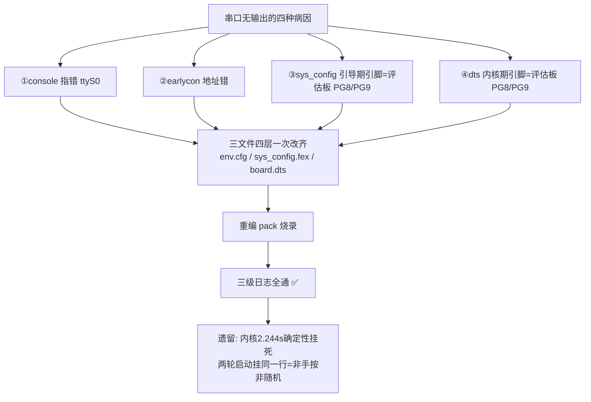

## 【考核①】debug 串口 · 能正常打印 ▶ 进行中（串口三级已通，还差系统跑稳）

> **存档说明**：本文是课程章节的原文存档（保留当时的写法与过程），文中如出现 `...` 等路径缩写，实际操作时以同节点 `README.md`（已写全路径）为准。


**验收标准（老师原话）**：debug 串口能正常打印。
**当前状态**：三级日志（boot0/U-Boot/内核）已全部从 PB6/PB7 打出 ✅；但内核 2.244 秒确定性挂死→看门狗复位循环 ❌——**系统未稳，不标完成**。

### 1. 框架



### 2. 原理（串口出日志的四层门）
内核 console（往哪个 tty 打）→ earlycon 地址（早期喇叭）→ sys_config [uart_para]（boot0/U-Boot 用哪两个脚）→ dts uart3_pins（内核用哪两个脚）。**任何一层配的是评估板引脚而不是本板引脚，日志就进"没人听的电话"**。本板硬件事实：UART3=PB6(TX)/PB7(RX)，寄存器 0x02500C00【数据手册p41+内核dtsi】。

### 3. 错误点与修改（三文件四层，全部亲手 sed 完成）

（以下为完整实操记录：侦察→验证→修改→编译→烧录→日志判读）

**背景**：烧录成功但串口安静（镜像名带 uart0 的预判部分命中，侦察后图景更清晰）。
**侦察三连（每层一条）+ 我看到的（关键日志原文）**：

① env.cfg（内核 console 层）：
```
第3行  earlycon=uart8250,mmio32,0x05000000     ← ❌ 地址错(UART3应为0x02500C00) 早期打印丢
第5行  console=ttyS3,115200                     ← ✅ 出厂就对！
```
② sys_config.fex（引导期串口层，5.4 方案特有）：
```
[uart_para]
uart_debug_port = 3                              ← 口号对(UART3)
uart_debug_tx = port:PG08<5><1><default><default>  ← ❌ 引脚是评估板的 PG8/PG9
uart_debug_rx = port:PG09<5><1><default><default>     我们板是 PB6/PB7 —— 自研板vs评估板差异实锤
```
③ board.dts（内核期引脚层）：
```
416: uart3_pins_a: uart3_pins@0   引脚组存在
782: &uart3                       节点存在(具体引脚和status待补)
```
**判读**：串口出日志需要四层对齐（console✓ / earlycon✗ / sys_config引脚✗ / dts引脚?）——侦察的意义=**改之前知道每一层谁对谁错，一次改齐**，不看就改=改A忘B，烧了还是安静还不知道怪谁。

**④⑤ 补齐最后两块拼图（sed 看指定行段）+ 我看到的**：
```
命令: sed -n '416,428p' .../evb1_auto_nand/board.dts
输出:
uart3_pins_a: uart3_pins@0 {  /* For t113_evb */
    pins = "PG8", "PG9";          ← ❌ 引脚=评估板的 PG8/PG9 → 要改 PB6/PB7
    function = "uart3";
    drive-strength = <10>;
    bias-pull-up;
};
uart3_pins_b: uart3_pins@1 {  /* For t113_evb */
    pins = "PG8", "PG9";          ← ❌ 睡眠态引脚组同样要改
    function = "gpio_in";
};

命令: sed -n '782,795p' .../evb1_auto_nand/board.dts
输出:
&uart3 {
    pinctrl-0 = <&uart3_pins_a>;
    pinctrl-1 = <&uart3_pins_b>;
    status = "okay";               ← ✅ 节点已启用，不用动
};
```

**四层终表（侦察完成，2026-09-29 晚）**：
| 层 | 文件 | 现状 | 要不要改 |
|---|---|---|---|
| 内核 console | env.cfg 第5行 | ttyS3 ✓ | 不改 |
| earlycon 地址 | env.cfg 第3行 | 0x05000000 ✗ | **改 0x02500C00** |
| 引导期引脚 | sys_config.fex [uart_para] | PG08/PG09 ✗ | **改 PB06/PB07** |
| 内核期引脚 | board.dts uart3_pins_a/b | PG8/PG9 ✗ | **改 PB6/PB7** |
| dts 节点状态 | board.dts &uart3 | okay ✓ | 不改 |

**⑥ 功能号三重验证（差点翻车的现场教学，2026-09-29 深夜）**：

sys_config 的引脚写法 `port:PG08<5>` 里 `<5>` = 复用功能号。改成 PB6 时功能号不能沿用 5——必须查证：

| 验证轮 | 来源 | 结果 |
|---|---|---|
| 1 | 数据手册 p41 复用表截图（视觉读） | 初读 F6=UART3-TX ⚠️但表头在截图外，视觉自注"按惯例推断" |
| 2 | **内核 C 表**（`kernel/linux-5.4/drivers/pinctrl/sunxi/pinctrl-sun8iw20.c` 第368-378行） | **PB6: 0x7="uart3" TX**（完整表：0x2=lcd0 D16/0x3=i2s2/0x4=twi3/0x5=pwm1/0x6=lcd0 D22/**0x7=uart3**/0x8=bist0） |
| 3 | 对照组 PG8（内核 C 表第1065行） | PG8: **0x5="uart3"** —— 与现有配置 `port:PG08<5>` 完全吻合 → 证明 sys_config 尖括号=内核功能号；且证明数据手册 F 列 = 内核号-1（手册不含 gpio 的 0/1）→ 截图视觉的"F6"实际对应内核 0x7 ✓ 两轮最终一致 |

```
内核C表原文（编译器真用的表，最高权威）：
SUNXI_PIN(SUNXI_PINCTRL_PIN(B, 6),
    SUNXI_FUNCTION(0x6, "lcd0"),   /* D22 */
    SUNXI_FUNCTION(0x7, "uart3"),  /* TX */  ← 我们要的
SUNXI_PIN(SUNXI_PINCTRL_PIN(B, 7),  （IC版第二 entry）
    SUNXI_FUNCTION(0x7, "uart3"),  /* RX */
```
**教学点**：视觉读数会猜表头（差点把 6 当功能号）；**内核 C 表是编译器真用的，最高权威**；对照 PG8 反推写法体系是闭环关键。不猜，查到编译器那一层为止。

**⑦ 修改方案定稿（三处，2026-09-29 深夜）**：
| 文件 | 原值 | 改为 | 依据 |
|---|---|---|---|
| evb1_auto_nand/openwrt/env.cfg 第3行 | earlycon=...0x05000000 | **0x02500C00** | UART3 寄存器地址【内核 dtsi: uart3@2500c00】 |
| evb1_auto_nand/sys_config.fex [uart_para] | port:PG08<5> / port:PG09<5> | **port:PB06<7> / port:PB07<7>** | 三重验证 |
| evb1_auto_nand/board.dts uart3_pins_a/b | pins = "PG8", "PG9" | **pins = "PB6", "PB7"** | dts 用字符串+function 名，驱动自查表 |
**⑧ 手动修改实操（2026-09-29 深夜，五组命令全文+逐条拆解）**

**改的是哪三个文件（都在 `~/T113-Tina5.0-V1.2/device/config/chips/t113/configs/evb1_auto_nand/` 下）**：
| 文件 | 管哪层 |
|---|---|
| `openwrt/env.cfg` | 内核启动参数（earlycon 地址） |
| `sys_config.fex` | 引导期串口（boot0/U-Boot 用哪两个脚） |
| `board.dts` | 内核期引脚复用（内核用哪两个脚） |

**第一组：备份（铁律：改任何文件前先备份）**
```bash
cd ~/T113-Tina5.0-V1.2/device/config/chips/t113/configs/evb1_auto_nand
```
拆解：`cd` = change directory 进入目录。`~` = 家目录。先站到方案目录里，后面命令就不用敲长路径。

```bash
cp openwrt/env.cfg openwrt/env.cfg.bak-0929
cp sys_config.fex sys_config.fex.bak-0929
cp board.dts board.dts.bak-0929
```
拆解：`cp 原文件 备份名` = 复制一份。备份名加 `.bak-0929`（bak=backup + 日期）是工程习惯。改坏了用 `cp 备份名 原名` 一秒还原。

**第二组：修改（三条 sed，每条拆到底）**
```bash
sed -i 's/0x05000000/0x02500C00/' openwrt/env.cfg
```
拆解：改的文件=**env.cfg（内核启动参数）**。`sed -i 's/旧/新/'` = stream editor 流编辑器，-i=in place 原地写回，s=substitute 替换。整句人话：**把 env.cfg 里的 0x05000000（错误的串口地址）全部换成 0x02500C00（UART3 的真地址，依据=内核 dtsi 里 uart3@2500c00）**。

```bash
sed -i 's/port:PG08<5>/port:PB06<7>/' sys_config.fex
sed -i 's/port:PG09<5>/port:PB07<7>/' sys_config.fex
```
拆解：改的文件=**sys_config.fex（引导期串口配置）**。人话：**把评估板的调试脚 PG8/PG9（功能号5）换成我们板子的 PB6/PB7（功能号7）**。注意 `<5>` 变 `<7>`——功能号是查内核 C 表三重验证来的（见⑥），不能沿用 5。

```bash
sed -i 's/pins = "PG8", "PG9"/pins = "PB6", "PB7"/g' board.dts
```
拆解：改的文件=**board.dts（设备树）**。结尾的 `g` = global 全局——board.dts 里 "PG8","PG9" 出现**两处**（uart3_pins_a 工作态 + uart3_pins_b 睡眠态），不加 g 只换第一处，第二处漏网=坑。dts 用"引脚名字符串+功能名"写法（function="uart3"），驱动自己查表，不用数字功能号。

**第三组：验证（改完必查——信不过手，信日志）**
```bash
grep -n "0x02500C00" openwrt/env.cfg
```
拆解：`grep -n 关键词 文件` = 在文件里搜关键词并显示行号。预期输出 1 行（第 3 行 earlycon 新地址）。

```bash
grep -n "uart_debug" sys_config.fex
```
预期输出 3 行：`uart_debug_port = 3` + `uart_debug_tx = port:PB06<7>...` + `uart_debug_rx = port:PB07<7>...`。

```bash
grep -n '"PB6"\|"PG8"' board.dts
```
预期：看到 pins = "PB6", "PB7" 的行；**如果还有任何 PG8 出现 = 漏改**（第三组 grep 就是抓漏网的）。

**第四组：重编+打包**
```bash
cd ~/T113-Tina5.0-V1.2 && ./build.sh && ./build.sh pack
```
拆解：`&&` = 前一条成功才跑下一条（失败即停，不会拿旧产物继续打包）。
**要多久**：增量编译约 **5-15 分钟**——这次只改了 3 个配置文件，make 的增量机制=只重编受影响的部分（内核+dts+重新组包）；上次的 40 分钟是 5.4 内核第一次从零全编（全量 vs 增量，术语见附录）。

**第五组：拉回 + 烧录（三个小步，每步拆解）**

**第 1 小步：把镜像从 VM 拉回 Windows（在 Windows 的 cmd 里跑，不是 VM！）**
- 怎么开 cmd：键盘 `Win + R` → 输入 `cmd` → 回车
```bat
scp -P 2222 karry@127.0.0.1:/home/karry/T113-Tina5.0-V1.2/out/t113_linux_evb1_auto_nand_uart0.img D:\t113_work\
```
- 拆解：`scp` = secure copy 走 SSH 通道传文件；`-P 2222` = 端口（**P 是大写**，小写 p 是保留时间戳）；`karry@127.0.0.1:路径` = 从 VM 的这个路径拉；最后是存到 Windows 的 D:\t113_work\ 目录
- 会提示输密码：`@Yao1881357`（屏幕不显示，输完回车）
- 预期输出（进度条走完）：
```
t113_linux_evb1_auto_nand_uart0.img    100%   21MB   18.6MB/s   00:01
```
- 验证拉到了：`dir D:\t113_work\t113_linux_evb1_auto_nand_uart0.img` → 应显示约 21MB 的文件

**第 2 小步：PhoenixSuit 烧录**
- 打开 `D:\t113_work\flash_tools\PhoenixSuit.exe`（**认准 2.0.1 这个，别用 zip 里的旧版**）
- 点"一键刷机" → 浏览选 `D:\t113_work\t113_linux_evb1_auto_nand_uart0.img` → 刷机模式选**全盘擦除升级**
- 板子操作（口诀：**断电→按住 LOAD→插 DEBUG 线→叮咚后 3 秒松开**）：
  1. 拔掉板子电源（完全断电）
  2. 手指按住 LOAD 键（丝印 SW1）不松
  3. 插 DEBUG 口的 TypeC 线连电脑（听到"叮咚"USB 提示音）
  4. 心里数 3 秒，松开 LOAD
- 预期：PhoenixSuit 开始滚进度，最后绿色大勾 = 烧录成功
- 常见弹窗：弹"固件版本太低"→ 点确定继续烧（正常）；设备管理器"描述符请求失败"→ 换 USB 口或重插

**第 3 小步：开串口看日志**
- 双击 `D:\t113_work\串口终端.bat`（自动连 COM4 @115200，能看能打字；只看不打的用"串口日志.bat"）
- 烧录完成后板子自动重启 → 串口窗口应开始滚日志
- 万一没滚：按一下板子 RST 复位键

**烧录后的判读预期（分三级说清）**：
| 阶段 | 预期 | 原因 |
|---|---|---|
| boot0 阶段 | 大概率仍无输出 ⚠️ | boot0 是 bin/ 预编译二进制，sys_config 改动影响不到它（编译期已固化）——待实验证实 |
| U-Boot 阶段 | **可能出**（待验证） | U-Boot 打包时吃 sys_config（开发指南 6.5 节），引脚改对了就可能上 UART3 |
| 内核阶段 | **应该出** | console=ttyS3 本来就对 + dts 引脚换成 PB6/PB7 + earlycon 地址修了 → 三层齐了 |
### 4. 烧录验证结果（2026-09-29 22:18——串口三级全通）

我看到的（金子行摘录，日志原文）：
```
[29]HELLO! BOOT0 is starting!          ← 第1棒 boot0 出日志（纯SDK自己的, commit 2386bdb825 / DRAM V0.34）
BOOT0 commit : 2386bdb825
DRAM BOOT DRIVE INFO: V0.34
U-Boot 2018.07-gce06dac (Mar 15 2025)  ← 第2棒 U-Boot（SDK自带，Mar2025构建）
Linux version 5.4.61 (karry@karry-VirtualBox) ... Tue Sep 29 17:53:27 CST 2026
                                        ← 第3棒=当天17:53自己编译的内核！
printk: bootconsole [earlycon0] enabled ← 手改的 earlycon 地址生效
uart3: ttyS3 at MMIO 0x2500c00          ← 手改的 dts 引脚生效
printk: console [ttyS3] enabled         ← console 全通
ubi0: user volume: 9, corrupted PEBs: 0 ← 纯SDK fes1 烧录 9 卷零损坏
```

**阶段判定**：**串口打印能力达成**（三级日志全部从 PB6/PB7 出来，纯 SDK 全链、三处修改全部亲手完成）——但内核随后挂死、系统未稳，**考核①保持 ▶ 进行中，不标完成**（见第 5 节）。

**⚠️ 认知大修正（boot0 出日志带来的推翻，诚实记录）**：
1. 当初 1 号"boot0 哑巴"的真因 ≠ "SDK 代际老"，而是 **sys_config 调试脚配在评估板 PG8/PG9 ≠ 我们板 PB6/PB7**（配置错位）。改了三处后纯 SDK boot0 立刻出声。
2. SDK 的 U-Boot 是 Mar 15 2025 构建（与老师固件 Feb 2025 同代）——"本 SDK 是 2023 年"的推断错误（它是 2025 代 Tina 5.0 V1.2）。
3. fes1/UBI 旧案需重新归因⚠️：当年 v1-v3 是"老师底座+我们文件"杂交镜像，本次纯 SDK fes1 烧录 9 卷全好——旧案可能源于杂交而非 fes1 代差（待复盘）。
4. 老师的批评依然成立且更深刻：**选错方案=没查表没查引脚**——方案里的引脚配置是给评估板的，自研板必须移植。


### 5. 挂死判定与排查（回答"是不是中途按复位"——2026-09-29 深夜）

**不是手按**。证据：日志含两轮完整启动（22:18:17 / 22:18:29），**两轮都精确挂在同一行**：
```
[2.244646] Loading compiled-in X.509 certificates   ← 两轮的最后一行，一字不差
```
之后静默→看门狗(timeout=16s)复位→再挂。手按复位是随机的，不可能两轮同毫秒同行——**确定性挂死=软件问题**（X.509 之后初始化的某个驱动）。
### 5.1 排查第一步：确认"挂死"是真的（排除人为因素）

**问的问题**：会不会是我中途按了复位键？
**怎么判断**：看日志有没有"两轮启动挂在同一行"。
**我看到的**：日志里有两轮完整启动（22:18:17 和 22:18:29 各一轮），**两轮的最后一行一字不差**都是：
```
[2.244646] Loading compiled-in X.509 certificates
```
**结论**：手按复位是随机的，不可能两轮都精确停在同一毫秒的同一行 → 这是**确定性挂死**（软件问题），不是人为。之后看门狗（16 秒超时，日志里有 `Watchdog enabled (timeout=16 sec)`）到点强制复位，形成死循环。

### 5.2 排查第二步：给内核装"照妖镜"（initcall_debug）

**原理**：内核有个调试开关 `initcall_debug`——打开后，每个驱动初始化时会打两行日志：`calling xxx_init`（进去了）和 `initcall xxx_init returned`（出来了）。**挂死时，最后一个"只有 calling 没有 returned"的驱动就是卡死的位置**——这就是定位挂死驱动的方法，不需要任何额外工具。
**改哪个文件**：`device/config/chips/t113/configs/evb1_auto_nand/openwrt/env.cfg`（U-Boot 传给内核的启动参数文件）
**改里面什么**：第 4 行 `initcall_debug=0` 改成 `initcall_debug=1`
**指令**：
```bash
sed -i 's/initcall_debug=0/initcall_debug=1/' ~/T113-Tina5.0-V1.2/device/config/chips/t113/configs/evb1_auto_nand/openwrt/env.cfg
```
**怎么确认改成功**：
```bash
grep -n initcall_debug ~/T113-Tina5.0-V1.2/device/config/chips/t113/configs/evb1_auto_nand/openwrt/env.cfg
```
看到第 4 行 `initcall_debug=1` 即成功（第 23-25 行的 `${initcall_debug}` 是变量引用，自动跟着变）。
**为什么只改 env.cfg 不用重编内核**：内核二进制没变，只是启动参数变了 → 只需 `./build.sh pack` 重新打包（env 打包时写进镜像的 env 分区）。

### 5.3 排查第三步：照妖镜下，挂死点后移到"补考"环节

**烧录后看到的**：内核不再挂死在 2.2 秒，一路跑到 9.75 秒——所有驱动的 calling/returned 都成对出现（没有凶手），**最后一行是**：
```
calling  deferred_probe_initcall+0x0/0x98 @ 1     ← 进去后没有对应的 returned
```
**这行是什么意思**：`deferred_probe_initcall` 是内核的"补考机制"。之前有些设备初始化时返回 -517（错误码 EPROBE_DEFER，意思是"我依赖的东西还没准备好，晚点再叫我"），内核就把它们记在小本本上，等所有初始化跑完后统一"补考"（重试一遍）。**现在卡死在补考环节 = 补考名单里有个设备，重试时把系统卡死了**。
**回查日志找补考名单**：搜 `returned -517`，发现 `probe of 2502c00.twi returned -517`——twi = I2C 控制器（sunxi 平台把 I2C 叫 twi）。其他 -517 的设备（几个时钟控制器 ccu）补考都成功了，唯独这个 twi 没有成功记录 → **锁定：补考这个 I2C 控制器时卡死**。

### 5.4 排查第四步：查 I2C 配置（三条指令，层层逼近）

**指令①**（看方案里有哪些 twi、触摸配在哪条总线）：
```bash
grep -n "twi" ~/T113-Tina5.0-V1.2/device/config/chips/t113/configs/evb1_auto_nand/board.dts | head -20
```
**输出重点**：
```
858: &twi0 {                          ← twi0 段开始
873:     ctp_twi_id = <0x2>;          ← 触摸控制器挂在 twi2
874:     ctp_twi_addr = <0x14>;       ← 触摸 I2C 地址 0x14（和我们板的 GT9xx 触摸吻合）
888: &twi1 {                          ← twi1 段开始
```
**判断**：触摸配置竟然写对了（twi2 + 0x14 正是我们板子的触摸）——评估板和我们板触摸同款。

**指令②**（看 twi0/twi1 段的完整内容，确认开没开）：
```bash
sed -n '858,900p' ~/T113-Tina5.0-V1.2/device/config/chips/t113/configs/evb1_auto_nand/board.dts
```
**输出重点**：
```
&twi0 { ... status = "disabled";      ← twi0 是关的
    ctp@14 { ... status = "disabled";
        ctp_int_port = <&pio PB 6 ...>;   ← ⚠️ 触摸中断脚配置为 PB6 —— 这是我们串口的 TX 脚!
        ctp_wakeup  = <&pio PB 7 ...>;    ← ⚠️ 触摸唤醒脚配置为 PB7 —— 这是我们串口的 RX 脚!
&twi1 { ... status = "disabled";      ← twi1 也是关的
```
**两个重要发现**：
1. twi0/twi1 都是 disabled（关闭状态）——关闭的设备内核不会启动，排除嫌疑；
2. **PB6/PB7 在评估板方案里被预定为触摸的中断/唤醒脚**——评估板的触摸物理上接在 PB6/PB7，我们板没有。当前因为 disabled 没有爆发，但这是记录在案的"地雷"（以后启用触摸时必须改成我们板的真实引脚）。
**顺便修正我自己的一次错误推理**：我最初猜"twi0 开着、挂空总线卡死"，指令②的输出证明它是 disabled——推理被证据推翻就作废，这正是"先看再改"的价值。

**指令③**（继续看 twi2/twi3 段）：
```bash
sed -n '900,960p' ~/T113-Tina5.0-V1.2/device/config/chips/t113/configs/evb1_auto_nand/board.dts
```
**输出重点**：
```
&twi2 { ... status = "disabled";      ← twi2 关的
&twi3 {
    ... status = "okay";              ← ⭐ 全文唯一开着的"异常"I2C！
    ac108: ac108@3B {                 ← 挂着一个 ac108 麦克风阵列(它自己又是 disabled)
        twi_bus = <0x1>;              ← 老式配置写法
&spi0 { ... status = "okay";          ← spi0 也开着，但它挂着我们启动必需的 spi-nand，不能动
```
**结论（凶手画像）**：twi0/1/2 全关，**唯独 twi3 开着**，而它上面唯一的孩子 ac108 又是 disabled——**一条开着的 I2C 总线，总线上没有任何设备**。评估板的 twi3 上接了麦克风芯片，我们板没有。deferred 补考遍历到这条"空转的总线"时卡死。

### 5.5 修改（精准打击，一行 sed）

**改哪个文件**：`device/config/chips/t113/configs/evb1_auto_nand/board.dts`（板级设备树——描述这块板"有什么硬件、接在哪个脚"的文件，内核靠它认硬件）
**改里面什么**：`&twi3` 段的 `status = "okay"` 改成 `status = "disabled"`（关掉这条空总线）
**为什么敢改**：twi3 上唯一的设备 ac108 本来就是 disabled，总线开着没有任何作用，只会引发卡死；我们板子（KelpBar）的麦克风（考核⑥）也不是接在 twi3，以后用到时按实际硬件重新配置。
**怎么避免误伤**：全文 `status = "okay"` 有十几处（spi0 也开着且不能动——它挂着启动必需的 spi-nand），所以用**带行号的 sed** 精准只改 twi3 那一行：
```bash
cp board.dts board.dts.bak-0930-twi3                 ← 先备份（铁律）
sed -i '912s/status = "okay"/status = "disabled"/' board.dts
```
拆解：`912s/...` = 只对第 **912** 行执行替换（行号写在 s 前面）。912 行来自上一节 sed -n 输出里 &twi3 块内 status 行的位置。
**改后必须验证**（顺序：先改后查是坏习惯，应该先确认行号再改、改后再查）：
```bash
grep -n 'status = "okay"' board.dts | head -10       ← 确认 twi3 那行已不在 okay 列表里
sed -n '905,915p' board.dts                          ← 眼见为实：twi3 块内已是 disabled，其他段没被误伤
```

### 5.6 修复后验证流程（全套你已熟练）
```bash
cd ~/T113-Tina5.0-V1.2 && ./build.sh && ./build.sh pack    ← dts 变了，真重编(约10分钟)+打包
```
→ Windows cmd: `scp -P 2222 karry@127.0.0.1:/home/karry/T113-Tina5.0-V1.2/out/t113_linux_evb1_auto_nand_uart0.img D:	113_work\`
→ PhoenixSuit 烧录（断电→按住 LOAD→插 DEBUG 线→叮咚 3 秒松）→ 串口终端看日志。
**预期里程碑**：deferred 补考顺利通过 → initcall 全部走完 → `Run /init as init process` → rootfs 挂载 → shell/login 出现 = **考核①完成**。
（验证结果：待补）

### 5.7 第二轮完整破案：twi3 与软链接陷阱（2026-09-30 上午，本日最精彩一课）

**照妖镜第二轮结果**：内核不再挂死在 2.2s，跑到 9.75s，所有 calling/returned 成对，最后一行卡在：
```
calling  deferred_probe_initcall+0x0/0x98 @ 1    ← 补考环节卡死
```
deferred_probe_initcall = 内核"补考"机制：之前返回 -517(依赖没好,晚点再试)的设备统一重试。回查日志：`probe of 2502c00.twi returned -517`(twi=I2C 控制器)——其他 -517 都补考成功，唯独它没有下文 → 锁定补考这个 I2C 时卡死。

**twi 侦察（三条指令+输出重点）**：
```
grep -n "twi" board.dts → 858:&twi0  873:ctp_twi_id=<0x2>(触摸配在twi2+0x14,与我们板GT9xx吻合!) 888:&twi1
sed -n '858,900p' → &twi0{...status="disabled"(关) 含ctp@14节点:
    ctp_int_port=<&pio PB 6...>  ← ⚠️地雷:评估板触摸中断脚=PB6(我们串口TX)
    ctp_wakeup =<&pio PB 7...>   ← ⚠️地雷:触摸唤醒脚=PB7(我们串口RX)  考核③触摸时要重配!
    &twi1{...status="disabled"
sed -n '900,960p' → &twi2{...disabled  &twi3{...status="okay"!!!  ← 唯一开着的空总线
    (twi3 上唯一设备 ac108 麦克风阵列自己也是 disabled; 我们板麦克风不接 twi3)
    &spi0{...okay (挂着启动必需的 spi-nand, 不能动!)
```
（勘误：2502c00=twi3 的控制器地址。地址序：twi0=2502000/1=2502400/2=2502800/3=2502c00，uart3=2500c00 相邻佐证。AI 曾误说成 twi0，已修正。）

**第一轮修复：改了但没上板（流程教训）**：sed 912 行关 twi3 → 验证源文件 disabled ✓ → 烧录 → 挂死一模一样。诊断三连发现：源文件被还原成 okay + 镜像时间戳早于修改 = 改动从未进入固件。

**第二轮：真凶落网——GNU sed -i 的软链接陷阱**
```
ls -la board.dts → board.dts -> linux-5.4/board.dts  (是个软链接!)
ls -la linux-5.4/board.dts → 时间戳 9月24(VM创建日,从未被改!)
diff linux-5.4/board.dts 备份 → 完全相同
head 内核目录board.dts → 没有那个文件
```
**机制**：GNU `sed -i` 修改软链接时 = 销毁链接、原地生成普通文件。所以 sed "board.dts"(链接) → 改的是独立新文件；grep/sed -n 验证读的也是新文件 → 显示 disabled（假象）；build 的 Setup 步骤发现布局被破坏 → 删新文件、重建标准软链接 → 编译读到的永远是 9月24 原版。
**金句**：验证和编译读的是两个文件——平行线不相交。
**正确修法**：绕开软链接，直接 sed 真身 `linux-5.4/board.dts`。

**第二轮结果：✅ 完美通关（11:13 日志）**
```
[9.70]  calling  deferred_probe_initcall
[10.20] initcall deferred_probe_initcall returned 0 after 484212 usecs  ← 卡点通过!
[11.02] VFS: Mounted root (squashfs filesystem) readonly               ← rootfs 挂载
[11.07] Run /init as init process
[14.80] procd: - early - / - watchdog - / - ubus - / - init -           ← openwrt init
[Please press Enter to activate this console.]                          ← shell 就绪!
```
（wpa_supplicant WERR 报错=WiFi 驱动未加载，考核⑦范围，不影响系统。）
注：twi3 禁用后 2502c00.twi 的 -517 探测也随之消失。

### 5.8 【考核①】盖章：✅ 完成（2026-09-30）

1. debug 串口三级日志全通（PB6/PB7，纯 SDK 自研链）
2. 系统完整启动：initcall 全过 → rootfs 挂载 → /init → procd → shell
3. 系统稳定运行（复位循环根治，twi3 关闭）
4. 三文件四层 + twi3 真身，全部亲手 sed（老师要求的"手动移植验证"达成）
5. 通向 shell 两条路：串口(串口终端.bat,看日志必用) / adb(VM 里 adb shell,传文件方便)——DEBUG TypeC 口两者兼用

**方法论沉淀（面试素材）**：官方表选型 / 串口四层门 / 功能号查内核 C 表 / initcall 照妖镜 / deferred_probe 补考 / **sed 软链接陷阱** / 验证关卡链（源→dtb→镜像→上板）

### 6. 手动复现记录（老师验收标准）
- [x] 亲手 lunch 选 3 号（查官方表选型）
- [x] 亲手 ./build.sh && ./build.sh pack（build OK + pack finish）
- [x] 亲手 sed 改三文件四层（备份→改→grep 验证输出见上文）
- [x] 亲手 scp 拉镜像 + PhoenixSuit 烧录
- [ ] 内核挂死修复（进行中）
- [ ] 系统到 login/shell（未达）
**完成判定：串口打印✅ + 系统稳定跑到 shell 之后，本章才改标 ✅**

---
