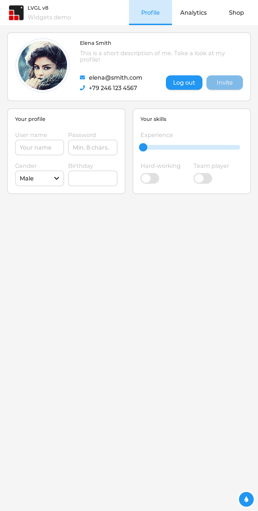

# 考核⑨ LVGL：无屏先行移植 —— 软件全就绪，等屏幕总成

> **目标**：LVGL 在板上跑起来（编译→部署→渲染→触摸接入全链路验证），换屏后插上就能看到画面。
> **状态**：✅ **软件侧 100% 完成**（2026-10-14：widgets demo 渲染实锤 + 触摸通路接入 + 显示引擎发送端实测在跑）；⏸ **仅差屏幕总成硬件**（FL7707 720×1424 MIPI 4lane）。
> **本关特殊性**：物理屏暂时看不到，但**显存里的画面能"云看"**——把 `/dev/fb0` 的内容拉回电脑转成图片。本手册全部验证都用这个方法完成，**不依赖屏幕**。
> **完全不需要烧录**：LVGL 是 adb push 的普通程序，与固件无关；固件里的显示驱动是原有配置，今天一个字节没动。

---

## 0. 一图定案：LVGL 已经在跑（板上 fb0 显存的真实内容）



这不是模拟器截图——是 `adb pull` 回来的 `/dev/fb0` 内容按 720×1424 解码出的 PNG，LVGL v8 官方 widgets demo（头像卡片/表单/滑条/开关）完整正确。

**显示引擎发送端也在实测工作**（`cat /sys/class/disp/disp/attr/sys` 关键行）：

```
mgr0: 720x1424 fmt[rgb] ... unblank          ← 显示控制器按 720×1424 跑
	lcd output	backlight( 50)	fps:51.5	 720x1424   ← 每秒 51.5 帧持续输出
	err:1	skip:185	irq:486434	vsync:0    ← vsync 中断 48.6 万次，引擎全速
```

芯片侧唯一没发生的物理事件是"光从屏里出来"——因为旧屏收不了。**换上同型号新屏，这套画面直接出现在屏上，软件零改动。**

---

## 1. 开工前准备

| # | 需要什么 | 怎么确认 | 没有/不对怎么办 |
|---|---|---|---|
| 1 | VM 能 SSH | `python D:\t113_work\ssh_run.py "uptime"` | 见踩坑 #1/#2（VM 卡死救援、密码认证） |
| 2 | Tina SDK 在 VM | `ssh_run.py "ls ~/T113-Tina5.0-V1.2"` | 之前考核已就绪 |
| 3 | 交叉工具链可用 | `ssh_run.py "ls ~/T113-Tina5.0-V1.2/openwrt/openwrt/staging_dir/toolchain/bin \| grep arm-openwrt-linux-gcc"` | 短名没有就 `ln -sf arm-openwrt-linux-gnueabi-gcc-8.3.0 arm-openwrt-linux-gcc`（bluealsa 配方） |
| 4 | 板子 adb 连通 | `adb devices` → `20080411 device` | 查 USB 线/DEBUG 口 |
| 5 | 知道三个终端的区别 | VM=编译 / Windows=adb / 板子=验证 | 见 01-serial 三窗口速查表 |

> **本关零硬件准备**：不烧录、不接线、屏幕不需要。全程 VM + adb。

## 2. 硬件与系统事实（有据版）

| 项目 | 值 | 证据（命令） |
|---|---|---|
| 显存设备 | `/dev/fb0`，**32bpp**，virtual_size **720,2848**（1424×2=双缓冲） | `cat /sys/class/graphics/fb0/bits_per_pixel` / `virtual_size` → 实测 `32` / `720,2848` |
| 分辨率 | 720×1424（FL7707 竖屏） | 考核④已配置并点亮过彩条 |
| 显示引擎实时状态 | fps:51.5、vsync 中断持续增长 | `cat /sys/class/disp/disp/attr/sys`（实测见第 0 部分） |
| 触摸设备 | **`/dev/input/event5`**（Name=`gt9xxnew_ts`，input5） | `cat /proc/bus/input/devices`（板上 event0~6 共 7 个输入设备，GT9xx 是 event5） |
| LVGL 版本 | **8.3.2**（库+移植层+模板三件套） | `lv_examples/Makefile` 里 `PKG_VERSION:=8.3.2` |
| 色深/渲染 | `LV_COLOR_DEPTH 32`，纯软件渲染（未开 G2D） | `lv_conf.h` 第 27 行；`lv_drv_conf.h` G2D 宏未开 |
| demo 开关 | widgets/music/benchmark/keypad/stress **全部已开** | `lv_conf.h` 728–748 行 `LV_USE_DEMO_* 1` |

> **深挖：为什么知道显示引擎"发送端"没坏？** `disp/attr/sys` 是显示驱动的实时状态窗口：`fps:51.5` 是当前帧率（不是启动时的），`irq:486434` 是 vsync 中断累计数（隔几秒再看在涨）。这两个数证明"LVGL→fb0→显示引擎→MIPI 发射"每秒都在发生 51.5 次。`err:1` 是启动以来累计 1 次的历史计数（当前无增长，无影响），`skip:185` 是可接受的丢帧统计。

## 3. 路线决策：怎么发现"什么都不用下载"（侦察过程实录）

### 第一步：课程路线查资料（结论：源码不在本地）

课程文档（`kbdoc_LVGL.txt` =《4、LVGL应用编程.pdf》全文提取）给出标准路线：**app_sdk_v2.tar.gz（51MB）+ toolchain-sunxi-glibc-gcc-830（409MB）**，都在百度网盘（提取码 etnq / y7nr），流程 `./build.sh -clean` → `./build.sh -t113` → adb push。

检查本地和 VM：`find /home/karry -iname '*app_sdk*' -o -iname '*toolchain-sunxi*'` → **零输出**（从没下载过）；且 VM 当前网络不通（`curl github.com` 无输出）——下载这条路走不通。

### 第二步：搜 SDK——惊喜发现

在 Tina SDK 里搜 LVGL：

```sh
find ~/T113-Tina5.0-V1.2/openwrt -maxdepth 4 -iname '*lvgl*'
# → openwrt/package/thirdparty/gui/lvgl-8/   ← 应用包目录
find ~/T113-Tina5.0-V1.2 -maxdepth 6 -type d \( -name lvgl -o -name lv_drivers \)
# → platform/thirdparty/gui/lvgl-8/lvgl        ← LVGL 库源码！
# → platform/thirdparty/gui/lvgl-8/lv_drivers ← 显示/输入移植层！
```

**三件套全在，且互相配套**（同一份全志提交）：

| 素材 | 位置（VM） | 是什么 |
|---|---|---|
| LVGL 库 | `~/T113-Tina5.0-V1.2/platform/thirdparty/gui/lvgl-8/lvgl` | LVGL 8.3.2 核心源码 |
| 移植层 | 同目录 `lv_drivers/` | `sunxifb.c`（fb 显示）+ `evdev.c`（触摸）等 |
| 应用模板 | `openwrt/package/thirdparty/gui/lvgl-8/lv_examples/src/` | `main.c` + `lv_conf.h` + `lv_drv_conf.h` + `Makefile` |
| 工具链 | `openwrt/openwrt/staging_dir/toolchain/bin` | gcc 8.3.0（bluealsa 同款） |

> 应用包 `lv_examples/Makefile`（OpenWrt 包格式）的 `Build/Prepare` 段直接揭示了三者的组装关系：
> ```make
> $(CP) -r $(SRC_CODE_DIR)/src $(PKG_BUILD_DIR)/            # 应用
> $(CP) -r $(SRC_CODE_DIR)/../lvgl $(PKG_BUILD_DIR)/src/     # 库
> $(CP) -r $(SRC_CODE_DIR)/../lv_drivers $(PKG_BUILD_DIR)/src/ # 移植层
> ```
> 既然构建系统只是"把三坨源码拷到一起再 make"，那**我自己拷到一起直接 make 就行**——绕开整个 OpenWrt 构建系统（不用 menuconfig、不用 30-40 分钟全量重编、不用重烧固件）。

### 路线对比定案

| 路线 | 代价 | 结论 |
|---|---|---|
| A. 课程 app_sdk_v2 | 网盘下载 460MB（且源码不在本地、VM 无网） | 备选，做项目应用时再上 |
| B. SDK lvgl-8 包走 OpenWrt 构建 | 全量重编 30-40 分钟 + 重烧 | 太重 |
| **C. 自带源码 + 手写 Makefile 直编** | **零下载、不重编固件、编译 3 分钟** | ✅ 本手册 |

## 4. ★ 移植过程：读了什么、改了什么、为什么（推理链）

### 4.1 读模板 main.c（136 行，全志调好的）——移植的"主战场"

```c
sunxifb_init(rotated);                    /* 打开 /dev/fb0，处理格式/双缓冲 */
sunxifb_get_sizes(&width, &height);       /* 自动读实际分辨率 → 720×1424（不用写死！）*/
buf = sunxifb_alloc(width*height*sizeof(lv_color_t), "lv_examples");  /* 画布 */
lv_disp_draw_buf_init(&disp_buf, buf, NULL, width*height);
disp_drv.flush_cb = sunxifb_flush;        /* LVGL 画完一块就回调它送进 fb */
disp_drv.hor_res = width;  disp_drv.ver_res = height;
lv_disp_drv_register(&disp_drv);          /* 显示通路注册完成 */

evdev_init();                             /* 打开 EVDEV_NAME 指定的输入设备 */
indev_drv.read_cb = evdev_read;           /* LVGL 定时来读坐标 */
lv_indev_drv_register(&indev_drv);        /* 触摸通路注册完成 */

while(1) { lv_task_handler(); usleep(5000); }   /* 主循环：每 5ms 处理一次渲染+输入 */
```

> **这就是 LVGL 跨平台的精髓**：LVGL 核心只认 `flush_cb`/`read_cb` 两个回调，完全不知道 fb0/event5 的存在；全志的 `sunxifb.c`/`evdev.c` 替你实现了硬件对接（open→ioctl 读尺寸→mmap 显存→memcpy/pan display；evdev 读 input_event 转坐标）。**所以"移植"在应用层只剩：确认设备号、编译、部署。**

### 4.2 全部修改只有一处（有依据）

`lv_drv_conf.h` 第 461 行：

```c
#  define EVDEV_NAME   "/dev/input/event3"   ← 全志评估板默认（他们板上有别的输入设备占前面）
```

改依据：板上 `cat /proc/bus/input/devices` 实测 `Name="gt9xxnew_ts"` 挂在 **input5 → /dev/input/event5**。所以：

```c
#  define EVDEV_NAME   "/dev/input/event5"   /* 本板 GT9xx，实测 input5 */
```

其余全部不动：`USE_SUNXIFB=1` 已开、`LV_COLOR_DEPTH 32` 与 fb 的 32bpp 天然匹配、demo 宏全开、`lv_conf.h` 内存池等配置是全志按这类板调好的。

### 4.3 编译方式：用模板自带的 Makefile，只换编译器

模板 `Makefile` 本来就是独立可用的（`include lvgl/lvgl.mk` + `lv_drivers/lv_drivers.mk` 收集全部源文件，`CC ?= gcc` 可被命令行覆盖）。所以交叉编译只需：

```sh
make CC=arm-openwrt-linux-gcc -j8
```

实测结果：**一次通过，EXIT=0**，产物 2,254,744 字节。`file` 确认：

```
lv_examples: ELF 32-bit LSB executable, ARM, EABI5 ... interpreter /lib/ld-linux-armhf.so.3
```

> **为什么能一次通过？** 库、移植层、配置、Makefile 全是全志为 T113 调好的成品，唯一变量是"宿主 gcc → 交叉 gcc"（`CC=` 覆盖解决）和"设备号"（sed 解决）。**移植工作量前置在"找对三件套"，而不是"改代码"。**
> 注意产物是**动态链接**的（依赖板上 libc）——Tina rootfs 自带，直接能跑，这也是不用静态编译的原因。

### 4.4 一键构建脚本（可重复）

以上过程固化成 `build_lvgl.sh`（VM `~/build_lvgl.sh`，仓库 [`patches/build_lvgl.sh`](patches/build_lvgl.sh)）：拷三件套 → sed 改设备号 → 交叉 make。**重编永远是干净环境 3 分钟**，不依赖"上次改过什么"。

## 5. 三步复刻（全部命令可复制）

### 第 1 步：VM 里一键编译

```sh
# VM 里（脚本已放 ~/build_lvgl.sh）
sh ~/build_lvgl.sh
# 结尾输出 BUILD_OK: /home/karry/lvgl_kelpbar/lv_examples
```

### 第 2 步：取回并推上板

```cmd
:: Windows（D:\t113_work 下）
python vm_get_b64.py /home/karry/lvgl_kelpbar/lv_examples D:/t113_work/lv_examples
MSYS_NO_PATHCONV=1 flash_tools\adb.exe push D:\t113_work\lv_examples /usr/bin/lv_examples
MSYS_NO_PATHCONV=1 flash_tools\adb.exe shell "chmod 755 /usr/bin/lv_examples"
```

> VM 的 sshd 无 SFTP，文件传输走 base64 通道（vm_get_b64.py），见 08-bt 文档附录。

### 第 3 步：运行（5 个 demo 任选）

```sh
# 板上（start-stop-daemon 后台跑，防 adb 会话断开杀进程——08-bt 的教训）
start-stop-daemon -S -b -m -p /var/run/lvgl.pid -x /usr/bin/lv_examples -- 0
# 参数：0=widgets  1=music  2=benchmark  3=keypad_encoder  4=stress
```

## 6. 验证关卡（无屏六关，全部实测通过）

| # | 查什么 | 命令 | 通过标准（实测值） |
|---|---|---|---|
| 1 | 进程活着 | `cat /var/run/lvgl.pid` + `ps \| grep lv_exa` | pid 存在，状态 S |
| 2 | **显示通路** | `ls -l /proc/<pid>/fd \| grep fb0` | `3 -> /dev/fb0` |
| 3 | **触摸通路** | `ls -l /proc/<pid>/fd \| grep event` | `4 -> /dev/input/event5` |
| 4 | 在渲染 | 隔 3 秒两次 `cat /proc/<pid>/stat` 取第 14 字段 | utime 52→56（动画在画） |
| 5 | **画面内容** | 第 7 部分云看屏 | widgets demo 完整界面 |
| 6 | **发送端在跑** | `cat /sys/class/disp/disp/attr/sys` | `fps:51.5` + `irq:486434`（持续增长） |

> 第 6 关是"换屏把握"的关键证据：它证明的不是一个静态画面，而是**芯片每秒 51.5 次把画面往 MIPI 发**。黑屏风险被压缩到"屏收不收"这一个纯硬件环节。

## 7. ★ 云看屏：fb0 dump 转图片（无屏时代的眼睛）

原理：LVGL 最终就是把像素写进 `/dev/fb0`。把显存原样拉回来，按"720 宽 × 1424 高 × 4 字节 BGRA"解码，就是屏上应有的画面。

```sh
# 板上：dump（virtual 是双缓冲 720×2848，前一半是当前显示帧）
cat /dev/fb0 > /tmp/fb.raw          # 8,202,240 字节 = 720×2848×4
# Windows：拉回
adb pull /tmp/fb.raw fb_lvgl.raw
```

```python
# Windows：转 PNG（需 pip install pillow）
from PIL import Image
data = open('fb_lvgl.raw','rb').read()
W,H = 720,1424
img = Image.frombytes('RGBA', (W,H), data[0:W*H*4], 'raw', 'BGRA')
img.save('lvgl_fb_dump.png')
```

> **为什么 BGRA**：fb 是 32bpp 小端，内存字节序 B,G,R,A。dump 出来红蓝互换就是字节序没对上。
> **换屏后这招照样用**：不用对屏拍照就能留画面证据（汇报/存档都干净）。

## 8. ★ 换屏后一次性点亮清单（当天 5 分钟）

### 8.0 先说把握（诚实版）

| 部分 | 把握 | 依据 |
|---|---|---|
| LVGL→显存→显示引擎→MIPI 发射（芯片侧全链） | **板上实测 100%** | 第 6 关的六个证据 |
| 显示配置对新屏适用 | 高（同一套 720×1424 时序，从未改过） | 旧屏就是这套配置点亮过彩条 |
| 新屏总成本身 | **软件管不到，买屏时确认** | 见 8.1 |

### 8.1 买屏时跟卖家逐条确认（5 项，截图留证）

| # | 必须确认 | 为什么 |
|---|---|---|
| 1 | 驱动 IC 是 **FL7707**（或明确兼容） | dts 时序按它配的 |
| 2 | 分辨率 **720×1424** | 错一个像素都不亮 |
| 3 | **MIPI DSI 4 lane** | lane 数错=黑屏 |
| 4 | 触摸芯片 **GT9 系列**（GT911 等） | 若换成其他 IC（如 FT 系列）需小改 dts 重编（考核③流程，可做但提前知道） |
| 5 | 排线接口与旧屏同规格（发原理图 FPC 座页给卖家核对） | 纯硬件装配风险 |

### 8.2 点亮步骤（软件零改动）

1. **不用烧录**——现有固件直接用（LVGL 不在固件里，`/usr/bin/lv_examples` 若被重烧清掉就重新 push，10 秒）
2. `adb shell "cat /sys/class/graphics/fb0/virtual_size"` → `720,2848`（显示链路活着）
3. `adb shell "cat /proc/bus/input/devices | grep -A3 gt9xx"` → **复核触摸还是不是 event5**（换了触摸 FPC 若 input 序号变：改 `~/lvgl_kelpbar/lv_drv_conf.h` 的 `EVDEV_NAME` → `sh ~/build_lvgl.sh` → 重推，3 分钟）
4. `start-stop-daemon -S -b -m -p /var/run/lvgl.pid -x /usr/bin/lv_examples -- 0`
5. **屏上直接出现 widgets demo**；手点下拉框/开关/滑条验证触摸
6. 想进阶：`lv_examples 2`（benchmark 帧率测试）、`lv_examples 1`（音乐播放器 demo）

### 8.3 万一黑屏：2 分钟决策树

```
echo 1 > /sys/class/disp/disp/attr/colorbar     （发彩条）
├─ 彩条亮  → 显示硬件链路 OK；问题只在 LVGL → 回看第 6 关逐条查（不可能走到这，已实锤）
└─ 彩条不亮 → 新屏适配/装配问题（时序、排线、供电），回考核④排查——与 LVGL 无关
```

## 9. 踩坑档案（本关实际发生的）

| # | 现象 | 真因 | 解法 |
|---|---|---|---|
| 1 | VM 开机后屏幕全黑、SSH 无 banner | 虚拟机偶发启动卡死（截屏确认黑屏+光标） | `VBoxManage controlvm t113-ubuntu poweroff` → `startvm t113-ubuntu --type headless` → 等 90 秒（数据不丢，实测恢复） |
| 2 | `ssh -p 2222` 报 `Permission denied (publickey,password)` | VM 认证是**密码**，本机密钥是 GitHub 的，VM 没装公钥 | 一律用 `python ssh_run.py "命令"`（paramiko+密码） |
| 3 | 课程路线 SDK/工具链不在本地、VM 又没网 | app_sdk_v2 只在百度网盘，从未下载 | **不下载**：Tina SDK 自带 lvgl-8 三件套+工具链（第 3 部分侦察法） |
| 4 | 直接 `make` 找不到编译器/报 fatal error | 工具链短名 + `STAGING_DIR` 环境变量 | PATH 加 toolchain/bin；export STAGING_DIR=staging_dir/target（bluealsa 同配方） |
| 5 | 触摸按全志默认 event3 会摸不到 | 本板 GT9xx 在 event5 | `lv_drv_conf.h` 改 `EVDEV_NAME`，换屏后复核（8.2 第 3 条） |
| 6 | `dmesg \| grep lcd` 空 | 板子 uptime 长，蓝牙/WiFi 日志把环形缓冲冲掉了 | 查实时状态节点（`disp/attr/sys`）比启动日志更权威 |

## 10. 常考问题

**Q1：屏幕坏着，你怎么证明 LVGL 真的在跑？**
A：六层证据（第 6 关）：①进程存活；②fd 握着 /dev/fb0 和 /dev/input/event5；③CPU 时间持续增长（动画渲染中）；④fb0 显存 dump 解码出完整正确画面；⑤显示引擎 fps:51.5、vsync 中断持续增长（发送端每秒都在发）；⑥同一套显示配置曾在旧屏点亮过彩条。**"无屏"只挡住了最后一环"光"，不挡任何软件环节。**

**Q2：为什么不用烧录？**
A：LVGL 是用户态程序，adb push 进 /usr/bin 就能跑，跟固件无关；显示驱动（dts 时序、disp/fb 驱动）是固件原有部分，本轮零修改。烧录反而会清掉 overlay 上的程序。**"改应用=push，改内核/设备树=重编固件"——这条分界线贯穿整个项目。**

**Q3：为什么不用课程的 app_sdk_v2？**
A：它要网盘下载 460MB 且本地没有；而 Tina SDK 自带的 lvgl-8（8.3.2）+全志移植层+8.3.0 工具链完全等价（同一个全志出的），且不用重编固件。课程 SDK 的价值在项目应用开发阶段（组件层封装、字库、PC 仿真），跑通 LVGL 本身两者无差别。

**Q4：LVGL 的显示驱动是怎么接上 fb0 的？**
A：分层解耦：LVGL 核心只调 `flush_cb` 回调交付渲染好的缓冲；全志 `sunxifb.c` 实现该回调——open fb0 → FBIOGET_VSCREENINFO 自动读尺寸 → mmap 显存 → flush 时写显存/pan display（双缓冲）。输入同理：`read_cb` ← evdev.c 从 event5 读 input_event 转坐标。**核心与硬件零耦合，这就是"移植=对接两个回调"的原因。**

**Q5：换新屏真的什么都不用改吗？**
A：软件配置零改动（同一套 720×1424 时序），但要按 8.1 的 5 项确认**新屏硬件规格一致**；唯一可能动软件的是触摸 IC 换型（event 号复核/compatible 修改），预案已写（8.2 第 3 条）。**不能说"100%"的原因只在硬件采购侧，不在软件侧。**

**Q6：widgets demo 在 720×1424 上显示会怪吗？**
A：LVGL 控件自适应父容器，demo 铺满实际分辨率；竖屏上半是内容、下半留白是 demo 按内容排布的正常现象（dump 图可见）。自己做应用用 `lv_disp_get_hor_res/ver_res` 取实际尺寸设计。

## 11. 文件路径全表

| 位置 | 路径 | 说明 |
|---|---|---|
| VM 构建目录 | `~/lvgl_kelpbar/` | lvgl 库 + lv_drivers + 模板（build_lvgl.sh 每次重建） |
| VM 一键脚本 | `~/build_lvgl.sh` | 拷贝→改设备号→交叉编译 |
| VM 产物 | `~/lvgl_kelpbar/lv_examples` | ARM ELF 2,254,744 B |
| Windows 二进制 | `D:\t113_work\lv_examples` | vm_get_b64.py 取回 |
| Windows 脚本副本 | `D:\t113_work\build_lvgl.sh` | 与 VM/仓库同步 |
| 板上程序 | `/usr/bin/lv_examples` | adb push，重烧会丢需重推 |
| 板上 pid | `/var/run/lvgl.pid` | start-stop-daemon -m 生成 |
| 源码（SDK 只读） | `platform/thirdparty/gui/lvgl-8/{lvgl,lv_drivers}` + `openwrt/package/thirdparty/gui/lvgl-8/lv_examples/src` | 不要直接改 SDK 里这份 |
| 仓库 | `09-lvgl/`（本手册 + patches/build_lvgl.sh + doc/images/） | 已推 GitHub |

## 12. 复刻自检清单

- [ ] 我知道 LVGL 源码/移植层/模板/工具链都在 Tina SDK 里（知道在哪些目录）
- [ ] 我能说清三条路线的取舍（为什么选 C：零下载/不重编固件/3 分钟）
- [ ] 我读懂了 main.c 的显示+输入注册流程（flush_cb/read_cb 解耦）
- [ ] 我知道唯一要改的是 `EVDEV_NAME`→event5，依据是 `/proc/bus/input/devices`
- [ ] 我跑通了 `sh ~/build_lvgl.sh`，产物 `file` 显示 ARM ELF
- [ ] 我用 adb push 部署并 start-stop-daemon 后台启动了 widgets demo
- [ ] 我验证了六关（进程/fd×2/utime/fb dump/disp fps）
- [ ] 我会云看屏（fb0 dump → BGRA 解码 PNG）
- [ ] 我能回答"不烧录的原因"和"无屏怎么证明在跑"
- [ ] 我背得出换屏当天 5 分钟清单和买屏 5 项确认

**全部打勾 = 你独立复刻成功。**

---

*软件就绪：2026-10-14 ｜ 编译环境：VM t113-ubuntu ｜ 产物：板上 /usr/bin/lv_examples ｜ 依赖固件：无（任意现有固件）｜ 提交：4f687ca、本次过程文档增补*
